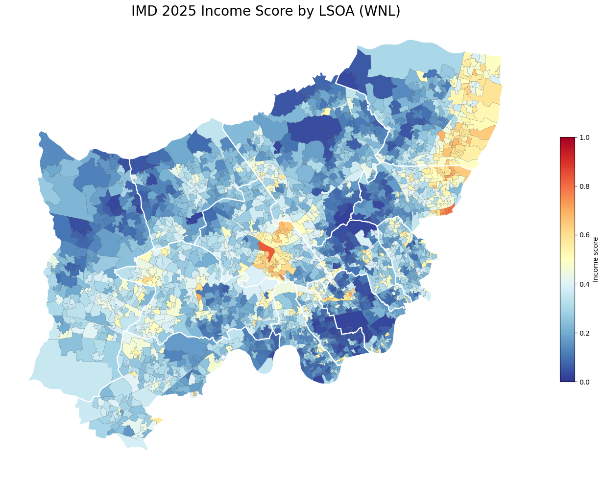

# Vignette 1: WNL-Wide Continuous Choropleth

This vignette shows how to plot a continuous choropleth of IMD income scores across all WNL boroughs, with borough boundary outlines and labels on top.

---

## Data

> In a Snowflake notebook, the queries below would be written in SQL cells. The cell name becomes the variable name passed into `prepare_geo_data()`.

**SQL cell: `df`** — LSOA-level IMD income scores for all WNL boroughs

```sql
SELECT
    IMD.LSOA_CODE_2021,
    IMD.LSOA_NAME_2021,
    IMD.LOCAL_AUTHORITY_DISTRICT_CODE_2024,
    IMD.LOCAL_AUTHORITY_DISTRICT_NAME_2024,
    IMD.INCOME_SCORE,
    LSOA.LATITUDE,
    LSOA.LONGITUDE,
    ST_ASWKB(LSOA.GEOGRAPHY) AS GEOMETRY_WKB
FROM DEV__MODELLING.LOOKUP_NCL.IMD_2025 AS IMD
JOIN DATA_LAKE__NCL.GEOSPATIAL_OBJECTS.LSOA_21 AS LSOA
    ON IMD.LSOA_CODE_2021 = LSOA.AREA_CODE
WHERE IMD.LOCAL_AUTHORITY_DISTRICT_NAME_2024 IN (
    'Barnet', 'Brent', 'Camden', 'Ealing', 'Enfield',
    'Hammersmith and Fulham', 'Haringey', 'Harrow',
    'Hillingdon', 'Hounslow', 'Islington',
    'Kensington and Chelsea', 'Westminster'
)
```

**SQL cell: `boundaries_df`** — Borough boundary geometries for all WNL boroughs

```sql
SELECT
    AREA_CODE,
    AREA_NAME,
    LATITUDE,
    LONGITUDE,
    ST_ASWKB(GEOGRAPHY) AS GEOMETRY_WKB
FROM DATA_LAKE__NCL.GEOSPATIAL_OBJECTS.CTYUA_DEC24
WHERE AREA_NAME IN (
    'Barnet', 'Brent', 'Camden', 'Ealing', 'Enfield',
    'Hammersmith and Fulham', 'Haringey', 'Harrow',
    'Hillingdon', 'Hounslow', 'Islington',
    'Kensington and Chelsea', 'Westminster'
)
```

---

## Plotting

```python
import wnl_mapkit as wm

# Convert WKB geometry to GeoDataFrames
imd_gdf = wm.prepare_geo_data(df)
boundaries_gdf = wm.prepare_geo_data(boundaries_df)

# Create canvas
wm.plot_map_canvas(figsize=(12, 10))

# Plot continuous choropleth of income score
wm.plot_static_continuous_choropleth(
    gdf=imd_gdf,
    column="INCOME_SCORE",
    title="IMD 2025 Income Score by LSOA (WNL)",
    legend_title="Income score",
    vmin=0,
    vmax=1,
    reverse=True,
    zorder=1,
)

# Overlay borough boundaries with labels
wm.plot_static_boundaries(
    gdf=boundaries_gdf,
    linewidth=1.5,
    linecolor="white",
    zorder=2,
    labels=True,
)
```



---

## Notes

- `reverse=True` flips the `RdYlBu` colourmap so that red represents higher deprivation (higher income score = higher need)
- `vmin=0, vmax=1` pins the colour scale to the full range of the income score, ensuring consistency across maps
- Borough boundaries are plotted on top (`zorder=2`) so they remain visible over the choropleth layer