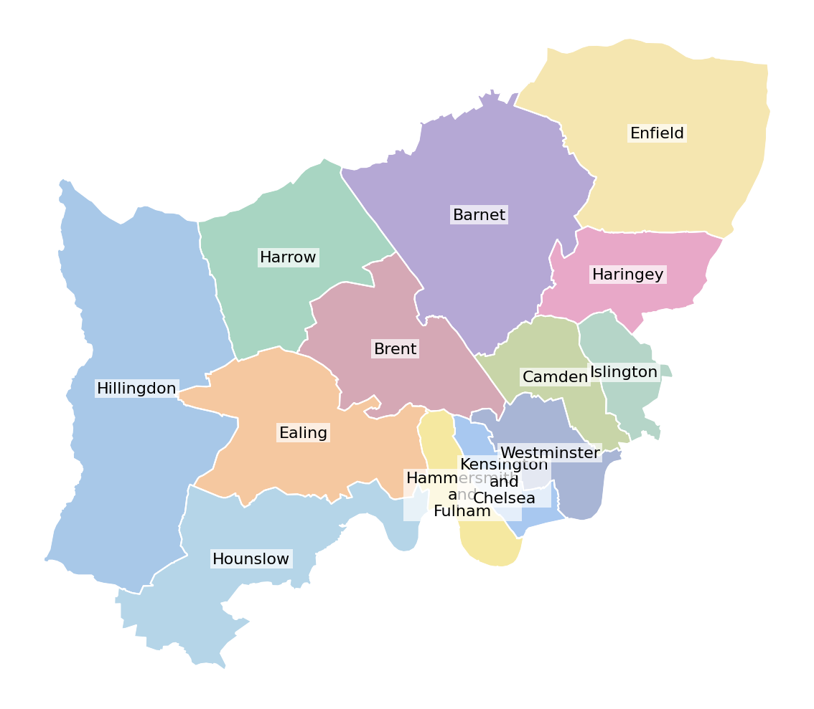

# Vignette 2: WNL Borough Base Map with Point Overlays

This vignette shows how to use the WNL branded borough base layer with labelled boundary outlines.

---

## Data

> In a Snowflake notebook, the query below would be written in SQL cells. The cell name becomes the variable name passed into `prepare_geo_data()`.

**SQL cell: `boundaries_df`** — Borough boundary geometries for all WNL boroughs

```sql
SELECT
    AREA_CODE,
    AREA_NAME,
    LATITUDE,
    LONGITUDE,
    ST_ASWKB(GEOGRAPHY) AS GEOMETRY_WKB
FROM DATA_LAKE__NCL.GEOSPATIAL_OBJECTS.CTYUA_DEC24
WHERE AREA_NAME IN (
    'Barnet', 'Brent', 'Camden', 'Ealing', 'Enfield',
    'Hammersmith and Fulham', 'Haringey', 'Harrow',
    'Hillingdon', 'Hounslow', 'Islington',
    'Kensington and Chelsea', 'Westminster'
)
```

---

## Plotting

```python
import wnl_mapkit as wm

# Convert WKB geometry to GeoDataFrames
boundaries_gdf = wm.prepare_geo_data(boundaries_df)

# Create canvas
wm.plot_map_canvas()

# Plot WNL branded borough base layer
wm.plot_wnl_boroughs_base(
    gdf=boundaries_gdf,
    fillstyle='pastel',
    linecolor='white',
    zorder=1,
)

# Overlay borough boundaries with labels
wm.plot_static_boundaries(
    gdf=boundaries_gdf,
    linewidth=1.5,
    linecolor='white',
    zorder=2,
    labels=True,
)

```



---

## Notes

- `plot_wnl_boroughs_base()` applies WNL branded colours to each borough — use `fillstyle='pastel'` for a softer look, `'bold'` for stronger brand colours, and `'plain'` for plain blue. 
- `plot_static_boundaries()` is called on the same GeoDataFrame to draw boundary lines and centroid labels on top of the filled polygons