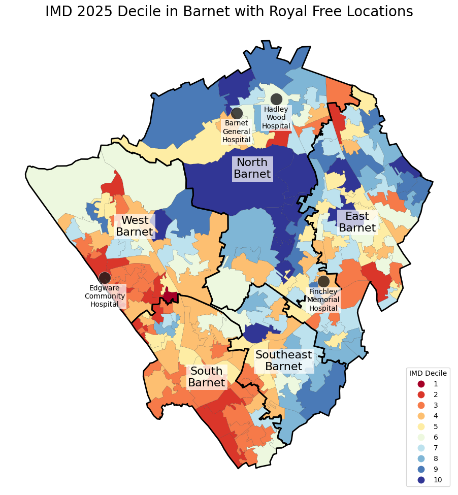

# Vignette 3: Single Borough Deep Dive — Barnet

This vignette shows how to produce a detailed map for a single borough, combining a categorical IMD decile choropleth at LSOA level with neighbourhood boundaries and labelled secondary care provider locations.

---

## Data

> In a Snowflake notebook, the queries below would be written in SQL cells. The cell name becomes the variable name passed into `prepare_geo_data()`.
The code below uses geographic objects from the `GEOSPATIAL_OBJECTS` schema.

**SQL cell: `df`** — LSOA-level IMD deciles for Barnet

```sql
SELECT
    IMD.LSOA_CODE_2021,
    IMD.LSOA_NAME_2021,
    IMD.LOCAL_AUTHORITY_DISTRICT_CODE_2024,
    IMD.LOCAL_AUTHORITY_DISTRICT_NAME_2024,
    IMD.IMD25_DECILE,
    ST_ASWKB(LSOA.GEOGRAPHY) AS GEOMETRY_WKB
FROM MODELLING.LOOKUP_NCL.IMD_2025 AS IMD
JOIN DATA_LAKE__NCL.GEOSPATIAL_OBJECTS.LSOA_21 AS LSOA
    ON IMD.LSOA_CODE_2021 = LSOA.AREA_CODE
WHERE IMD.LOCAL_AUTHORITY_DISTRICT_NAME_2024 = 'Barnet'
```

**SQL cell: `boundaries_df`** — Neighbourhood boundary geometries within Barnet

```sql
SELECT
    AREA_CODE,
    AREA_NAME,
    ST_ASWKB(GEOGRAPHY) AS GEOMETRY_WKB
FROM DATA_LAKE__NCL.GEOSPATIAL_OBJECTS.NCL_NEIGHBOURHOOD_BOUNDARIES
WHERE AREA_NAME IN (
    'North Barnet', 'West Barnet', 'East Barnet',
    'South Barnet', 'Southeast Barnet'
)
```

**SQL cell: `locations_df`** — Secondary care provider locations in Barnet

```sql
SELECT
    LOCATION_NAME,
    PROVIDER_NAME,
    PROVIDER_CODE,
    ST_ASWKB(GEOGRAPHY) AS GEOMETRY_WKB
FROM DATA_LAKE__NCL.GEOSPATIAL_OBJECTS.NCL_SECONDARY_PROVIDER_LOCATIONS
WHERE LOCAL_AUTHORITY = 'Barnet'
AND PROVIDER_CODE = 'RAL'
```

---

## Plotting

```python
import wnl_utils.mapkit as wm

# Convert WKB geometry to GeoDataFrames
imd_gdf = wm.prepare_geo_data(df)
boundaries_gdf = wm.prepare_geo_data(boundaries_df)
barnet_acute_gdf = wm.prepare_geo_data(locations_df)

# Create canvas
wm.plot_map_canvas()

# Plot categorical IMD decile choropleth at LSOA level
wm.plot_static_categorical_choropleth(
    gdf=imd_gdf,
    column="IMD25_DECILE",
    title="IMD 2025 Decile in Barnet with Royal Free Locations",
    legend_title="IMD Decile",
    categories=[1, 2, 3, 4, 5, 6, 7, 8, 9, 10],
    reverse=False,
    zorder=1,
)

# Overlay neighbourhood boundaries
wm.plot_static_boundaries(
    gdf=boundaries_gdf,
    linewidth=2,
    linecolor="black",
    zorder=2,
    labels=True
)

# Overlay secondary care locations with labels
wm.plot_static_coordinates(
    gdf=barnet_acute_gdf,
    pointstyle="black",
    pointsize=300,
    zorder=3,
    labels=True,
    label_column="LOCATION_NAME",
)
```



---

## Notes

- `categories=[1, 2, 3, 4, 5, 6, 7, 8, 9, 10]` explicitly sets the full decile range so the legend is consistent even if some deciles are not present in the data
- `reverse=False` means decile 1 (most deprived) maps to red and decile 10 (least deprived) maps to blue
- `pointsize=300` and `labels=True` work well at a single borough and provider scale — at WNL-wide scale these would clutter the map. 

